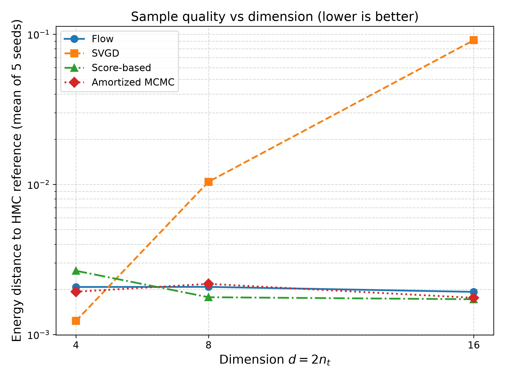

# Learning Multidimensional Jeffreys Constellations

This repository contains the code from my research internship at CNRST (Rabat), summer 2026.

The problem: designing good input constellations for a massive-MIMO channel. Yang & Combes (2025) show that sampling from a power-tilted Jeffreys prior gives good constellations, but their reference construction costs Θ(M^d) and becomes impractical as the number of antennas grows.

What I did: I implemented and compared four samplers that scale with the dimension (a RealNVP normalizing flow, SVGD, annealed Langevin dynamics and amortized MCMC), and evaluated them against an HMC reference with MMD², energy distance, permutation tests and mutual information.

Main result: the flow, score-based and amortized-MCMC samplers stay at MMD² ≈ 2×10⁻⁴ up to d = 16, while SVGD degrades quickly with dimension.

While cleaning the code for publication, I found a bug in the power constraint of the MIMO oracle (B1, see Known limitations). It does not affect the comparison between samplers, but it does affect the mutual-information comparison with PAM. Fixing it is my next step.

## Target

Power-tilted Jeffreys prior of a massive-MIMO channel with imperfect CSI, following Yang & Combes (2025), [arXiv:2504.13325](https://arxiv.org/abs/2504.13325):

$$w_J(\theta) \propto \sqrt{\det J(\theta)}\; e^{-\lambda^\* c(\theta)}, \qquad c(\theta) = \lVert\theta\rVert^2,\ \theta \in \mathbb{R}^{d},\ d = 2n_t,$$

where $J(\theta)$ is the Fisher information of the channel and $\lambda^\*$ is the Lagrange multiplier of the average power constraint $\mathbb{E}[c(\theta)] = P$.
The samples are used as finite input constellations. The reference construction (**Approach I**, successive conditional approximation, `approach1/`) costs $\Theta(M^d)$; **Approach II** (`approach2/`) replaces it with samplers that scale with the dimension.

## Methods

| Method | Type | File |
|---|---|---|
| RealNVP normalizing flow (reverse-KL training) | learned, parametric | `approach2/flow.py`, `approach2/train.py` |
| Stein Variational Gradient Descent (RBF kernel, median heuristic) | particles | `approach2/svgd.py` |
| Annealed Langevin dynamics with the exact score (autograd) | score-based | `approach2/score_based.py` |
| Amortized MCMC: independent Metropolis–Hastings with the trained flow as proposal | MCMC | `approach2/amortized_mcmc.py` |
| HMC (4 chains), used only as the **independent reference** for the metrics | MCMC | `approach2/mcmc_reference.py` |

## Results: sample quality vs dimension

Setting: isotropic imperfect-CSI MIMO oracle, $\sigma^2 = 0.1$, $A = 10$, $P = A^2/9$, $N = 5000$ samples, 5 seeds (42–46), reference = HMC samples.

**Metric note.** The column called "MMD" in the JSON files and reports is the **squared MMD, MMD²**: `compute_mmd_rbf` returns $\overline{k_{xx}} + \overline{k_{yy}} - 2\overline{k_{xy}}$ (biased V-statistic, Gaussian kernel, median-heuristic bandwidth).

Sources: `approach2/evaluation_metrics.json`, `svgd_metrics.json`, `score_metrics.json`, `amortized_metrics.json`, `mi_curve_results.json`, summarised in `approach2/docs/PROGRESS_REPORT.md` §6.1.

| $n_t$ ($d$) | Method | MMD² mean ± std | Energy distance mean ± std | ESS/N (or acceptance rate) | MI, M=256 (bits) |
|---|---|---|---|---|---|
| 2 (4) | Flow | 0.000233 ± 0.000078 | 0.002074 ± 0.000524 | 0.9951 | 7.35 |
| | SVGD | 0.000134 ± 0.000046 | 0.001231 ± 0.000341 | N/A | 7.54 |
| | Score | 0.000321 ± 0.000183 | 0.002659 ± 0.001274 | N/A | 7.32 |
| | Amortized MCMC | 0.000218 ± 0.000120 | 0.001928 ± 0.000826 | AR 96.5 % | 7.32 |
| 4 (8) | Flow | 0.000208 ± 0.000072 | 0.002077 ± 0.000505 | 0.9839 | 7.95 |
| | SVGD | 0.002174 ± 0.000114 | 0.010408 ± 0.000550 | N/A | 7.97 |
| | Score | 0.000170 ± 0.000045 | 0.001772 ± 0.000302 | N/A | 7.95 |
| | Amortized MCMC | 0.000222 ± 0.000087 | 0.002175 ± 0.000591 | AR 94.5 % | 7.88 |
| 8 (16) | Flow | 0.000195 ± 0.000051 | 0.001924 ± 0.000374 | 0.9902 | 8.00 |
| | SVGD | 0.019581 ± 0.000480 | 0.091280 ± 0.002384 | N/A | 7.92 |
| | Score | 0.000166 ± 0.000037 | 0.001718 ± 0.000247 | N/A | 8.00 |
| | Amortized MCMC | 0.000168 ± 0.000043 | 0.001755 ± 0.000302 | AR 95.1 % | 7.93 |

SVGD is the best method at $d = 4$, but its MMD² is about 10× the flow's at $d = 8$ and about 100× at $d = 16$.



Permutation tests, power check, flow robustness, mutual-information curves, complexity, the Approach I ADC experiment and the full reproduction commands are in **[docs/RESULTS.md](docs/RESULTS.md)**.

## Known limitations

These were found while cleaning the code for publication. They are **not fixed**: every result above was produced by the code as it is.

- **B1: power constraint not met by the isotropic MIMO oracle.**
  - *Cause:* `solve_lambda_star_mimo_radial` solves for λ* with the base-2 convention $2^{-\lambda c}$ (`exp(-λ·ln2·r²)`), but `log_w_J_mimo` uses `exp(-λ·r²)`.
  - *Effect:* under the sampled density, E‖θ‖² ≈ 8.36 / 8.68 / 8.77 (measured on the HMC references) instead of P = 11.11.
  - *Scope:* the MMD², energy-distance, ESS and permutation comparisons are unaffected, because every method and the HMC reference target the same density. The **flow vs PAM MI comparison is biased against the flow**, since PAM is normalised to P, and the SNR values in the report are off.
  - Documented by the `xfail` test `tests/test_oracle_mimo.py::test_sampled_density_satisfies_power_constraint`.
- **B2: radial density factor.** `radial_unnorm_density` (`approach2/oracle_mimo.py`, `approach1/validate_step4.py`) uses $2\sigma^4/(1-\sigma^2)$ in the $\det J$ correction term. The coded $J(\theta)$ implies $4\sigma^4/(1-\sigma^2)$. This has a small effect on λ* and still needs checking against the paper.
- **B3: "Jeffreys 1D" MI baseline.** In `mi_curve.py`, this baseline uses $M_{1d}^d$ points instead of $M$. For example, M = 4 gives 16 points and hence 4 bits > log₂4. Its values in `mi_curve_results.json` cannot be compared with the other columns, so it is not plotted. In the same file, the PAM grid has fewer than M points for $n_t = 2$ at M = 32 (16 points) and M = 128 (81 points).
- **B4: permutation-test noise baseline.** The "HMC vs HMC" baseline compares two halves of 2500 samples, while the observed statistic uses 5000 vs 5000. Because the MMD² estimator is biased (V-statistic), the baseline is inflated. "Observed < baseline" at $n_t = 8$ is therefore not a like-for-like comparison.
- **B5: $n_t = 4$ anomaly check.** `nt4_anomaly_check.py` adds zero-mean random noise of 1–2 % std, whereas `power_analysis.py` applies a deterministic shift. The two experiments measure different perturbations

## Known issues

- **λ\* solver/density mismatch (B1).** In `oracle_mimo.py`, the λ\* solver uses `exp(-λ·ln2·r²)` (line 53) while the density uses `exp(-λ·r²)` (line 45). As a result, E‖θ‖² ≈ 8.6 instead of the power constraint P = 11.11.
  - Sampler-vs-sampler comparisons (MMD²) remain valid, since all samplers target the same density.
  - The mutual-information comparison against PAM is biased and should not be interpreted until this is fixed.

## Installation and tests

```bash
conda create -n jeffreys python=3.11 && conda activate jeffreys
pip install -r requirements.txt
pytest                      # ~2 s on CPU
```

Scripts use flat imports and relative paths: run them from their own folder. Figures are regenerated from the JSON result files with `python figures/generate_synthesis_figures.py` (from the repo root). See [docs/RESULTS.md](docs/RESULTS.md#full-reproduction-commands) for everything else.

## Repository structure

```
approach1/        Approach I: λ* (lambda_star.py), polynomial fits (polyfit.py),
                  successive conditional construction (jeffreys_baseline.py),
                  Blahut–Arimoto (blahut_arimoto.py), validation steps 1–6, reports
approach2/        Approach II
  oracle*.py        target log-densities (AWGN, non-Gaussian, MIMO isotropic, full CSI)
  flow.py train.py  RealNVP and reverse-KL training
  svgd.py score_based.py amortized_mcmc.py mcmc_reference.py
  diagnostics.py    ESS, MMD², energy distance
  jeffreys_flow/    small Oracle / Sampler interface
  validate_*.py evaluate_*.py benchmark_*.py mi_curve.py ...   experiments
  *.json *.png      results;  checkpoints/ trained flows;  mcmc_reference_nt*.pt HMC references
  docs/             PROGRESS_REPORT.md (French), methodology_note.md, debug_log.md
  notebooks/        week 3 / week 4 notebooks
docs/             RESULTS.md: detailed results and reproduction commands
figures/          synthesis figures and the script that generates them
tests/            pytest suite (oracle, flow, diagnostics, Blahut–Arimoto, λ*, samplers)
archive/          one-off scripts kept for traceability (report patches, pilots, old protocols)
```

## Acknowledgments

I thank Mr. Redouane Merrouch, Professor at the Mohammadia School of Engineering (EMI) and Head of the MARWAN service at CNRST (Rabat, Morocco), for supervising this internship (summer 2026). This work builds on the paper by Yang & Combes (arXiv:2504.13325).

Part of the code and of this documentation was written with the help of AI assistants. All experiments were run, checked and interpreted by the author.

## License

Apache License 2.0, see [LICENSE](LICENSE).
