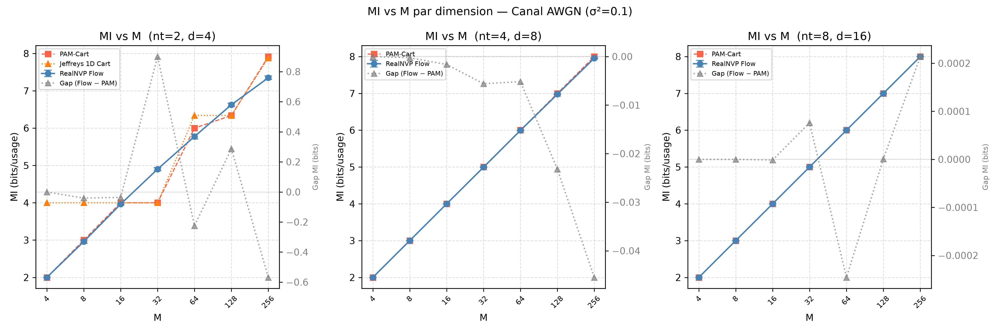

# Learning Multidimensional Jeffreys Constellations

Research internship, CNRST, summer 2026.

The goal is to sample from the **power-tilted Jeffreys prior** of a massive-MIMO channel with imperfect CSI, following Yang & Combes (2025), [arXiv:2504.13325](https://arxiv.org/abs/2504.13325):

$$w_J(\theta) \propto \sqrt{\det J(\theta)}\; e^{-\lambda^\* c(\theta)}, \qquad c(\theta) = \lVert\theta\rVert^2,\ \theta \in \mathbb{R}^{d},\ d = 2n_t,$$

where $J(\theta)$ is the Fisher information of the channel and $\lambda^\*$ is the Lagrange multiplier of the average power constraint $\mathbb{E}[c(\theta)] = P$.
The samples are then used as finite input constellations, and we measure the resulting mutual information.

The reference construction from the paper (**Approach I**, successive conditional approximation) costs $\Theta(M^d)$.
**Approach II** replaces it with learned or particle samplers that scale with the dimension:

| Method | Type | File |
|---|---|---|
| RealNVP normalizing flow (reverse-KL training) | learned, parametric | `approach2/flow.py`, `approach2/train.py` |
| Stein Variational Gradient Descent (RBF kernel, median heuristic) | particles | `approach2/svgd.py` |
| Annealed Langevin dynamics with the exact score (autograd) | score-based | `approach2/score_based.py` |
| Amortized MCMC: independent Metropolis–Hastings with the trained flow as proposal | MCMC | `approach2/amortized_mcmc.py` |
| HMC (4 chains), used only as the **independent reference** for the metrics | MCMC | `approach2/mcmc_reference.py` |

## Main results

Setting: isotropic imperfect-CSI MIMO oracle, $\sigma^2 = 0.1$, $A = 10$, $P = A^2/9$, $N = 5000$ samples, 5 seeds (42–46), reference = HMC samples.
All numbers are copied from the result files cited in each table.

**Metric note.** The column called "MMD" in the JSON files and reports is the **squared MMD, MMD²**: `compute_mmd_rbf` returns $\overline{k_{xx}} + \overline{k_{yy}} - 2\overline{k_{xy}}$ (biased V-statistic, Gaussian kernel, median-heuristic bandwidth). It is reported as MMD² below.

### Sample quality vs dimension

Sources: `approach2/evaluation_metrics.json`, `svgd_metrics.json`, `score_metrics.json`, `amortized_metrics.json`, `mi_curve_results.json`, summarised in `approach2/docs/PROGRESS_REPORT.md` §6.1.

| $n_t$ ($d$) | Method | MMD² mean ± std | Energy distance mean ± std | ESS/N (or acceptance rate) | MI, M=256 (bits) |
|---|---|---|---|---|---|
| 2 (4) | Flow | 0.000233 ± 0.000078 | 0.002074 ± 0.000524 | 0.9951 | 7.35 |
| | SVGD | 0.000134 ± 0.000046 | 0.001231 ± 0.000341 | N/A | 7.54 |
| | Score | 0.000321 ± 0.000183 | 0.002659 ± 0.001274 | N/A | 7.32 |
| | Amortized MCMC | 0.000218 ± 0.000120 | 0.001928 ± 0.000826 | AR 96.5 % | 7.32 |
| 4 (8) | Flow | 0.000208 ± 0.000072 | 0.002077 ± 0.000505 | 0.9839 | 7.95 |
| | SVGD | 0.002174 ± 0.000114 | 0.010408 ± 0.000550 | N/A | 7.97 |
| | Score | 0.000170 ± 0.000045 | 0.001772 ± 0.000302 | N/A | 7.95 |
| | Amortized MCMC | 0.000222 ± 0.000087 | 0.002175 ± 0.000591 | AR 94.5 % | 7.88 |
| 8 (16) | Flow | 0.000195 ± 0.000051 | 0.001924 ± 0.000374 | 0.9902 | 8.00 |
| | SVGD | 0.019581 ± 0.000480 | 0.091280 ± 0.002384 | N/A | 7.92 |
| | Score | 0.000166 ± 0.000037 | 0.001718 ± 0.000247 | N/A | 8.00 |
| | Amortized MCMC | 0.000168 ± 0.000043 | 0.001755 ± 0.000302 | AR 95.1 % | 7.93 |

Takeaways:
- The flow, score-based and amortized-MCMC samplers stay at MMD² ≈ 2×10⁻⁴ up to $d = 16$.
- SVGD degrades with dimension: its MMD² is about 10× the flow's at $d = 8$ and about 100× at $d = 16$.


### Flow vs HMC: permutation test (1000 permutations) and internal noise baseline

Source: `approach2/permutation_results.json`, script `approach2/permutation_test.py`.

| $n_t$ ($d$) | Metric | Observed (flow vs HMC) | p-value | Baseline HMC vs HMC (mean ± std) |
|---|---|---|---|---|
| 2 (4) | MMD² | 0.000425 | 0.012 | 0.000395 ± 0.000192 |
| | Energy dist. | 0.003378 | 0.012 | 0.003610 ± 0.001379 |
| 4 (8) | MMD² | 0.000275 | 0.046 | 0.000245 ± 0.000066 |
| | Energy dist. | 0.002387 | 0.051 | 0.002694 ± 0.000461 |
| 8 (16) | MMD² | 0.000171 | 0.330 | 0.000325 ± 0.000063 |
| | Energy dist. | 0.001772 | 0.295 | 0.003335 ± 0.000441 |

Power check (`approach2/power_analysis_results.json`): shifting the flow samples by 1 % of their standard deviation gives an MMD² p-value of 0.002 at $n_t = 8$, so the test is still sensitive at $d = 16$.
At $n_t = 2$ the p-values are 0.019 (1 %), 0.014 (2 %) and 0.0 (5 %); at $n_t = 4$ they are 0.473 (1 %), 0.217 (2 %) and 0.0 (5 %).

HMC reference diagnostics (`approach2/docs/PROGRESS_REPORT.md` §4): max R-hat = 1.001 / 1.000 / 1.000, min ESS ≈ 993 / 1264 / 5000, acceptance = 75.7 % / 65.0 % / 79.9 % for $n_t$ = 2 / 4 / 8.

### Flow robustness (ESS/N during validation runs)

Source: `approach2/docs/debug_log.md`.

| Case | λ* | ESS/N |
|---|---|---|
| 1D Gaussian (AWGN) | TODO | 0.9995 |
| 2D Gaussian | TODO | 0.9980 |
| 1D non-Gaussian, $J = 1 + \theta^2$ | 0.0792 | 0.9228 |
| MIMO isotropic, $n_t$ = 2 / 4 / 8 | 0.1440 / TODO / TODO | 0.9943 / 0.9846 / 0.9885 |
| Full CSI, anisotropic Γ (ratio 3), σ² = 0.1 | 0.1016 | 0.9973 |
| Full CSI stress test, σ² = 0.5 (σ²‖θ‖² ≈ 5.86) | 0.0560 | 0.9952 |

These are single training-validation runs. The 5-seed values in the first table (0.9951 / 0.9839 / 0.9902) come from `evaluation_metrics.json`.

### Mutual information vs constellation size

Source: `approach2/mi_curve_results.json`. Blahut–Arimoto on an empirical AWGN transition matrix ($N_Y = 2000$, max_iter = 500, tol = 1e-6). The baseline is a Cartesian PAM grid.

| $n_t$ | M | Flow (bits, mean ± std) | PAM (bits) |
|---|---|---|---|
| 2 | 64 | 5.7742 ± 0.0673 | 5.9995 |
| 2 | 256 | 7.3485 ± 0.0482 | 7.9171 |
| 4 | 256 | 7.9545 ± 0.0083 | 8.0000 |
| 8 | 256 | 7.9997 ± 0.0001 | 7.9995 |

At $n_t$ = 4 and 8, both constellations are close to $\log_2 M$: with $M \le 256$ points in 8–16 dimensions, the space is too sparse to tell methods apart.
Read this section together with limitations B1 and B3 below.



### Complexity

- **Approach I** (`approach1/benchmark_complexity_report.md`, imperfect-CSI case, M = 4):
  - `build()` takes 0.53 s at $d = 2$ and 27.01 s at $d = 4$;
  - at $d = 4$, it takes 19.47 s / 21.92 s / 21.28 s / 23.64 s for M = 3 / 4 / 5 / 6.
- **Flow log-det, GPU, batch of 1000** (`approach2/benchmark_logdet_complexity.json`):
  - trained models: 2.079 / 2.531 / 3.005 ms for $d$ = 4 / 8 / 16 with L = 8 / 10 / 12 coupling layers;
  - control at fixed $d = 8$ with the same three architectures: 1.986 / 2.454 / 2.960 ms. **The growth comes from depth L, not from d;**
  - fixed architecture: roughly constant (~1.95 ms, fitted exponent b ≈ 0.00) for $d \le 64$, then 14.12 ms at $d = 4096$ and 62.16 ms at $d = 16384$ (from the report).
- **Sampling time for 5 seeds** (`wall_time_s` in the JSON files):
  - SVGD: 73.89 s / 95.59 s / 141.91 s;
  - score-based: 15.81 s / 15.25 s / 15.03 s, for $n_t$ = 2 / 4 / 8.


### Approach I: uniform MI on an 8-level ADC channel

Source: `approach1/benchmark_mutual_information_report.md`. P = 2.78; the AWGN capacity at this power is C ≈ 0.9588 bits.

| M | 2 | 10 | 20 | 30 | 50 | 100 |
|---|---|---|---|---|---|---|
| Approach I (bits) | 0.5249 | 0.7962 | 0.8276 | 0.8391 | 0.8486 | 0.8507 |
| PAM (bits) | 0.7691 | 0.8319 | 0.8326 | 0.8328 | 0.8329 | 0.8329 |

## Known limitations

These were found while cleaning the code for publication. They are **not fixed**: every result above was produced by the code as it is.

- **B1: power constraint not met by the isotropic MIMO oracle.**
  - *Cause:* `solve_lambda_star_mimo_radial` solves for λ* with the base-2 convention $2^{-\lambda c}$ (`exp(-λ·ln2·r²)`), but `log_w_J_mimo` uses `exp(-λ·r²)`.
  - *Effect:* under the sampled density, E‖θ‖² ≈ 8.36 / 8.68 / 8.77 (measured on the HMC references) instead of P = 11.11.
  - *Scope:* the MMD², energy-distance, ESS and permutation comparisons are unaffected, because every method and the HMC reference target the same density. The **flow vs PAM MI comparison is biased against the flow**, since PAM is normalised to P, and the SNR values in the report are off.
  - Documented by the `xfail` test `tests/test_oracle_mimo.py::test_sampled_density_satisfies_power_constraint`.
- **B2: radial density factor.** `radial_unnorm_density` (`approach2/oracle_mimo.py`, `approach1/validate_step4.py`) uses $2\sigma^4/(1-\sigma^2)$ in the $\det J$ correction term. The coded $J(\theta)$ implies $4\sigma^4/(1-\sigma^2)$. This has a small effect on λ* and still needs checking against the paper.
- **B3: "Jeffreys 1D" MI baseline.** In `mi_curve.py`, this baseline uses $M_{1d}^d$ points instead of $M$. For example, M = 4 gives 16 points and hence 4 bits > log₂4. Its values in `mi_curve_results.json` cannot be compared with the other columns. In the same file, the PAM grid has fewer than M points for $n_t = 2$ at M = 32 (16 points) and M = 128 (81 points).
- **B4: permutation-test noise baseline.** The "HMC vs HMC" baseline compares two halves of 2500 samples, while the observed statistic uses 5000 vs 5000. Because the MMD² estimator is biased (V-statistic), the baseline is inflated. "Observed < baseline" at $n_t = 8$ is therefore not a like-for-like comparison.
- **B5: $n_t = 4$ anomaly check.** `nt4_anomaly_check.py` adds zero-mean random noise of 1–2 % std, whereas `power_analysis.py` applies a deterministic shift. The two experiments measure different perturbations.

## How to reproduce

```bash
conda create -n jeffreys python=3.11 && conda activate jeffreys
pip install -r requirements.txt
pytest                      # ~2 s on CPU
```

Scripts use flat imports and relative paths: **run them from their own folder**.

```bash
cd approach1
python validate_step1.py ... validate_step4.py   # λ*, polynomial fits, radial check (III-D)
python step5.py                                  # complexity benchmark -> step5_complexity.png
python validate_step6.py                         # ADC mutual information -> step6_mutual_information.png

cd ../approach2
python validate_oracle.py; python validate_invertibility.py
python validate_flow_1d.py; python validate_flow_2d.py; python validate_nongaussian.py
python validate_mimo_nt2.py; python validate_mimo_nt4.py; python validate_mimo_nt8.py   # (re)train flows
python mcmc_reference.py                 # HMC references (skipped if mcmc_reference_nt*.pt exist)
python evaluate_flow_metrics.py          # -> evaluation_metrics.json
python evaluate_svgd_metrics_gpu.py      # -> svgd_metrics.json
python evaluate_score_metrics_gpu.py     # -> score_metrics.json
python evaluate_amortized_metrics_gpu.py # -> amortized_metrics.json
python permutation_test.py; python power_analysis.py; python nt4_anomaly_check.py
python mi_curve.py; python run_mi_curve_svgd.py; python run_mi_curve_score.py; python run_mi_curve_amortized.py
python benchmark_logdet_complexity.py; python benchmark_L_isolation.py; python benchmark_large_d.py

cd ..
python figures/generate_synthesis_figures.py; python figures/plot_nt8.py   # run from the repo root
```

Notes:
- The `validate_mimo_nt*.py` scripts **overwrite** the committed checkpoints in `approach2/checkpoints/`.
- `mi_curve.py` and `run_mi_curve_*.py` resume from `mi_curve_results.json`. Move that file away to recompute from scratch.
- The GPU timings were measured on an NVIDIA RTX 4060 Laptop GPU (CUDA 12.1).
- The exact Approach I benchmark configuration reported in `benchmark_complexity_report.md` is not reproduced by the current `step5.py` parameters.

## Repository structure

```
approach1/        Approach I: λ* (lambda_star.py), polynomial fits (polyfit.py),
                  successive conditional construction (jeffreys_baseline.py),
                  Blahut–Arimoto (blahut_arimoto.py), validation steps 1–6, reports
approach2/        Approach II
  oracle*.py        target log-densities (AWGN, non-Gaussian, MIMO isotropic, full CSI)
  flow.py train.py  RealNVP and reverse-KL training
  svgd.py score_based.py amortized_mcmc.py mcmc_reference.py
  diagnostics.py    ESS, MMD², energy distance
  jeffreys_flow/    small Oracle / Sampler interface
  validate_*.py evaluate_*.py benchmark_*.py mi_curve.py ...   experiments
  *.json *.png      results;  checkpoints/ trained flows;  mcmc_reference_nt*.pt HMC references
  docs/             PROGRESS_REPORT.md (French), methodology_note.md, debug_log.md
  notebooks/        week 3 / week 4 notebooks
figures/          synthesis figures and the scripts that generate them
tests/            pytest suite (oracle, flow, diagnostics, Blahut–Arimoto, λ*, samplers)
archive/          one-off scripts kept for traceability (report patches, pilots, old protocols)
```

## Acknowledgments

TODO: supervisor acknowledgment.

Part of the code and of this documentation was written with the help of AI assistants. All experiments were run, checked and interpreted by the author.

## License

Apache License 2.0, see [LICENSE](LICENSE).
