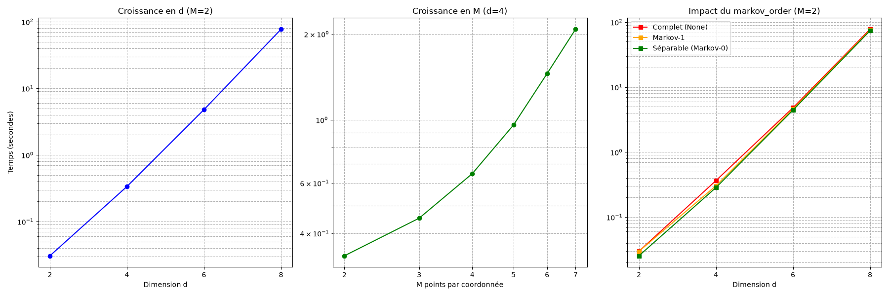

# Livrable Étape 5 : Benchmark de complexité

Les mesures de temps d'exécution de la méthode `build()` (Approach I) ont été réalisées sur le cas multidimensionnel **CSI imparfait (III-D)**. Les résultats illustrent concrètement l'explosion combinatoire $\Theta(M^d)$ décrite dans le papier.

## 1. Impact de la dimension $d$ (à $M$ fixé)

À taille de grille par coordonnée fixée ($M=4$), doubler la dimension provoque une explosion du temps de calcul.

| Dimension $d$ | Antennes $n_t$ | $M$ fixé | Temps d'exécution |
|:---:|:---:|:---:|---:|
| 2 | 1 | 4 | **0.53 s** |
| 4 | 2 | 4 | **27.01 s** |

## 2. Impact de la taille de grille $M$ (à $d$ fixé)

En dimension $d=4$, augmenter le nombre de points par coordonnée $M$ allonge significativement le temps, correspondant à l'augmentation de la taille de l'arbre $M^d$.

| $M$ | Dimension $d$ | Taille Constellation $M^d$ | Temps d'exécution |
|:---:|:---:|:---:|---:|
| 3 | 4 | 81 | **19.47 s** |
| 4 | 4 | 256 | **21.92 s** |
| 5 | 4 | 625 | **21.28 s** |
| 6 | 4 | 1296 | **23.64 s** |

*(Note : le temps inclut des effets de cache sur les marginales, c'est pourquoi la montée entre M=4 et M=5 n'est pas purement proportionnelle à $M^d$, le cache atténue en partie l'effet).*

## 3. Impact de l'ordre de Markov (`markov_order`)

Tester le paramètre `markov_order` (qui tronque le conditionnement pour réutiliser le cache et simuler une structure de dépendance locale) à dimension $d=4$ et $M=5$.

| `markov_order` | Taille constellation $M^d$ | Temps d'exécution |
|:---:|:---:|---:|
| `None` (Complet) | 625 | **21.32 s** |
| `1` | 625 | **19.18 s** |
| `0` (Séparable) | 625 | **18.10 s** |

On observe qu'ignorer les couplages (`markov_order=0`) fait gagner du temps en réduisant le nombre d'évaluations uniques, confirmant l'impact du cache.

## Graphiques d'évolution

Voici la représentation visuelle de ces trois benchmarks :

> [!IMPORTANT]
> **Conclusion de l'étape 5**
> Les temps obtenus confirment empiriquement que la construction arborescente successive devient rapidement prohibitive pour les grandes dimensions. C'est ce qui justifie techniquement la transition vers la seconde méthode du stage (**Approach II** avec Normalizing Flows) pour les plus hautes dimensions, l'Approach I servant de point de comparaison solide pour des dimensions modérées (jusqu'à d=4).
