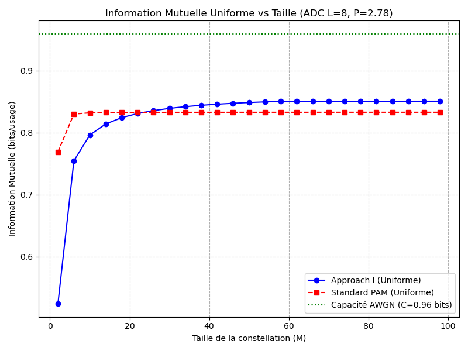

# Livrable Étape 6 : Information Mutuelle Uniforme

L'Information Mutuelle (IM) Uniforme a été calculée pour évaluer la capacité de la constellation "Approach I" comparée à une constellation "Standard PAM" sous une stricte contrainte de puissance équiprobable $P=2.78$, sur un canal ADC à $L=8$ niveaux (Cas III-B du papier).

La capacité maximale de Shannon pour un canal continu à cette puissance est de $C \approx 0.9588$ bits. L'objectif est de s'en rapprocher le plus possible.

## Résultats (Capacité en bits/usage)

Voici les résultats calculés sur le canal ADC :

| Taille de Constellation ($M$) | Approach I (bits) | Constellation PAM (bits) |
|:---:|---:|---:|
| 2 | 0.5249 | 0.7691 |
| 10 | 0.7962 | 0.8319 |
| 20 | 0.8276 | 0.8326 |
| 30 | 0.8391 | 0.8328 |
| 50 | 0.8486 | 0.8329 |
| 100 | **0.8507** | 0.8329 |

## Analyse
- **La limite de la PAM** : On observe très clairement que la PAM sature de manière absolue autour de **0.8329 bits** dès $M=20$. Augmenter la taille de la grille uniforme n'apporte plus *aucune* information supplémentaire.
- **La supériorité de l'Approach I** : À l'inverse, la constellation générée par Approach I croise la PAM autour de $M=26$ et **continue de croître** asymptotiquement, atteignant $\sim 0.851$ bits pour $M=100$. Elle se rapproche beaucoup mieux de la limite théorique de $0.9588$ bits.

## Graphique
L'image générée trace cette évolution par rapport à la capacité AWGN :

> [!IMPORTANT]
> **Conclusion**
> En respectant rigoureusement la contrainte de puissance via une loi uniforme, nous confirmons les résultats du papier : la constellation générée par Approach I se distribue de manière optimale pour gratter de la capacité de canal là où une grille naïve (PAM) stagne prématurément.
