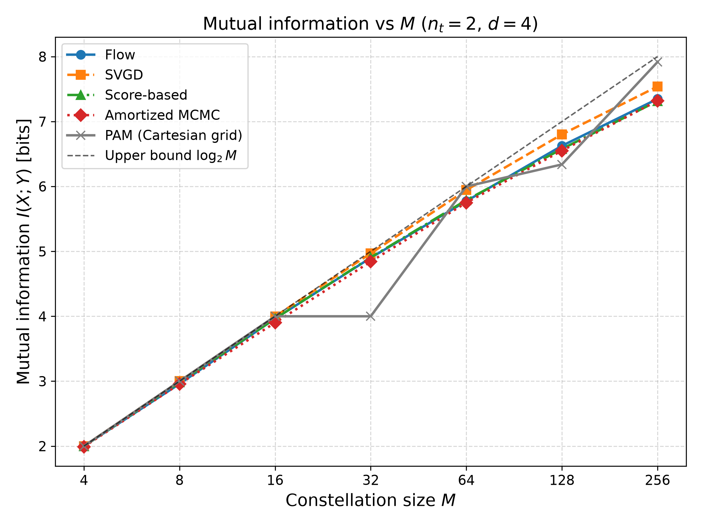
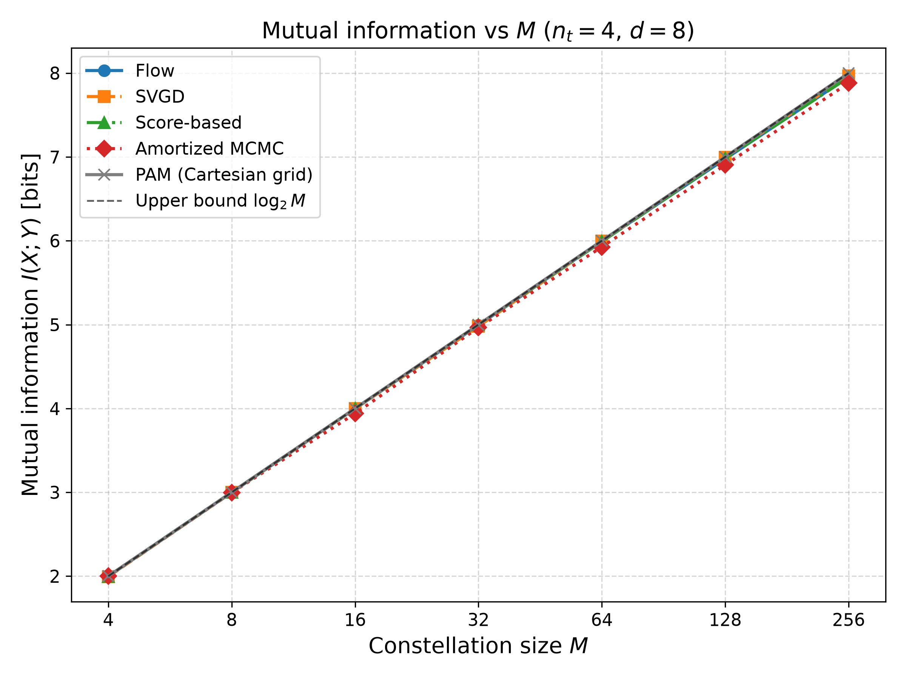
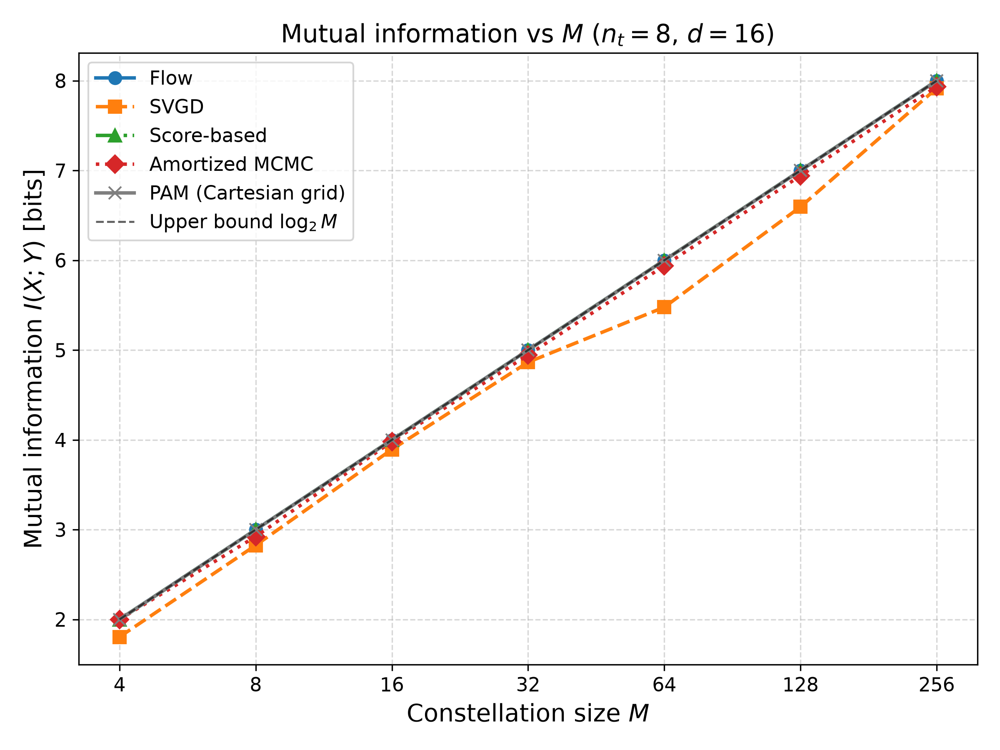
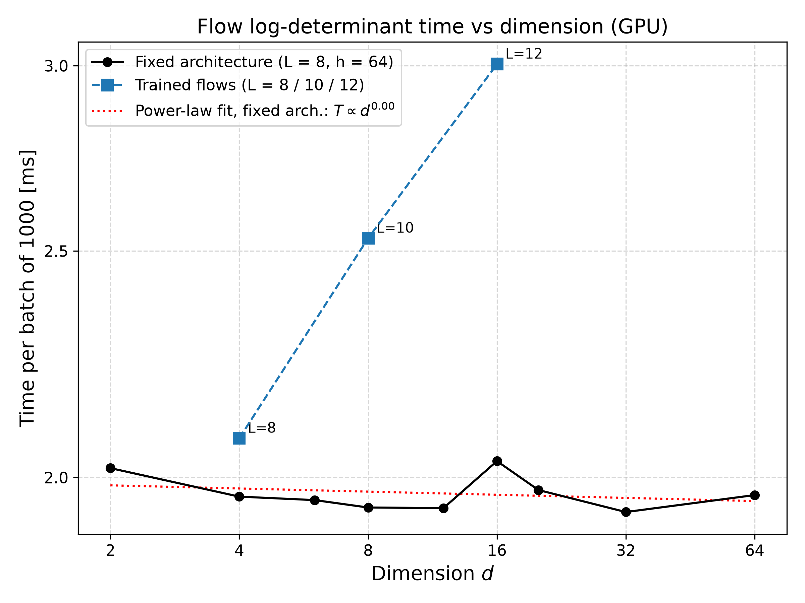

# Detailed results

Back to the [README](../README.md). The setting, the metric note (MMD² vs MMD) and the main quality-vs-dimension table are in the README.
All numbers below are copied from the result files cited under each table. Read them together with the [Known limitations](../README.md#known-limitations) B1–B5.

## Flow vs HMC: permutation test (1000 permutations) and internal noise baseline

Source: `approach2/permutation_results.json`, script `approach2/permutation_test.py`.

| $n_t$ ($d$) | Metric | Observed (flow vs HMC) | p-value | Baseline HMC vs HMC (mean ± std) |
|---|---|---|---|---|
| 2 (4) | MMD² | 0.000425 | 0.012 | 0.000395 ± 0.000192 |
| | Energy dist. | 0.003378 | 0.012 | 0.003610 ± 0.001379 |
| 4 (8) | MMD² | 0.000275 | 0.046 | 0.000245 ± 0.000066 |
| | Energy dist. | 0.002387 | 0.051 | 0.002694 ± 0.000461 |
| 8 (16) | MMD² | 0.000171 | 0.330 | 0.000325 ± 0.000063 |
| | Energy dist. | 0.001772 | 0.295 | 0.003335 ± 0.000441 |

The noise baseline is not like-for-like with the observed statistic (limitation B4).

## Power check

Source: `approach2/power_analysis_results.json`, script `approach2/power_analysis.py`.

Shifting the flow samples by 1 % of their standard deviation gives an MMD² p-value of 0.002 at $n_t = 8$, so the test is still sensitive at $d = 16$.
At $n_t = 2$ the p-values are 0.019 (1 %), 0.014 (2 %) and 0.0 (5 %); at $n_t = 4$ they are 0.473 (1 %), 0.217 (2 %) and 0.0 (5 %).

The $n_t = 4$ anomaly check (`approach2/nt4_anomaly_check.py`) uses a different perturbation (limitation B5).

## HMC reference diagnostics

Source: `approach2/docs/PROGRESS_REPORT.md` §4.

Max R-hat = 1.001 / 1.000 / 1.000, min ESS ≈ 993 / 1264 / 5000, acceptance = 75.7 % / 65.0 % / 79.9 % for $n_t$ = 2 / 4 / 8.

## Flow robustness (ESS/N during validation runs)

Source: `approach2/docs/debug_log.md`.

| Case | λ* | ESS/N |
|---|---|---|
| 1D Gaussian (AWGN) | TODO | 0.9995 |
| 2D Gaussian | TODO | 0.9980 |
| 1D non-Gaussian, $J = 1 + \theta^2$ | 0.0792 | 0.9228 |
| MIMO isotropic, $n_t$ = 2 / 4 / 8 | 0.1440 / TODO / TODO | 0.9943 / 0.9846 / 0.9885 |
| Full CSI, anisotropic Γ (ratio 3), σ² = 0.1 | 0.1016 | 0.9973 |
| Full CSI stress test, σ² = 0.5 (σ²‖θ‖² ≈ 5.86) | 0.0560 | 0.9952 |

These are single training-validation runs. The 5-seed values in the README table (0.9951 / 0.9839 / 0.9902) come from `evaluation_metrics.json`.

## Mutual information vs constellation size

Source: `approach2/mi_curve_results.json`. Blahut–Arimoto on an empirical AWGN transition matrix ($N_Y = 2000$, max_iter = 500, tol = 1e-6). The baseline is a Cartesian PAM grid.

| $n_t$ | M | Flow (bits, mean ± std) | PAM (bits) |
|---|---|---|---|
| 2 | 64 | 5.7742 ± 0.0673 | 5.9995 |
| 2 | 256 | 7.3485 ± 0.0482 | 7.9171 |
| 4 | 256 | 7.9545 ± 0.0083 | 8.0000 |
| 8 | 256 | 7.9997 ± 0.0001 | 7.9995 |

At $n_t$ = 4 and 8, both constellations are close to $\log_2 M$: with $M \le 256$ points in 8–16 dimensions, the space is too sparse to tell methods apart.
Because of B1, the flow vs PAM comparison is biased against the flow. The "Jeffreys 1D" baseline stored in the JSON is not plotted (B3); at $n_t = 2$ the PAM grid has fewer than M points for M = 32 and M = 128 (B3), which explains the plateaus of the PAM curve.

Figures generated by `figures/generate_synthesis_figures.py` (Flow, SVGD, score-based, amortized MCMC, PAM and the $\log_2 M$ bound):





## Complexity

- **Approach I** (`approach1/benchmark_complexity_report.md`, imperfect-CSI case, M = 4):
  - `build()` takes 0.53 s at $d = 2$ and 27.01 s at $d = 4$;
  - at $d = 4$, it takes 19.47 s / 21.92 s / 21.28 s / 23.64 s for M = 3 / 4 / 5 / 6.
- **Flow log-det, GPU, batch of 1000** (`approach2/benchmark_logdet_complexity.json`):
  - trained models: 2.079 / 2.531 / 3.005 ms for $d$ = 4 / 8 / 16 with L = 8 / 10 / 12 coupling layers;
  - control at fixed $d = 8$ with the same three architectures: 1.986 / 2.454 / 2.960 ms. **The growth comes from depth L, not from d;**
  - fixed architecture: roughly constant (~1.95 ms, fitted exponent b ≈ 0.00) for $d \le 64$, then 14.12 ms at $d = 4096$ and 62.16 ms at $d = 16384$ (from the report).
- **Sampling time for 5 seeds** (`wall_time_s` in the JSON files):
  - SVGD: 73.89 s / 95.59 s / 141.91 s;
  - score-based: 15.81 s / 15.25 s / 15.03 s, for $n_t$ = 2 / 4 / 8.



## Approach I: uniform MI on an 8-level ADC channel

Source: `approach1/benchmark_mutual_information_report.md`. P = 2.78; the AWGN capacity at this power is C ≈ 0.9588 bits.

| M | 2 | 10 | 20 | 30 | 50 | 100 |
|---|---|---|---|---|---|---|
| Approach I (bits) | 0.5249 | 0.7962 | 0.8276 | 0.8391 | 0.8486 | 0.8507 |
| PAM (bits) | 0.7691 | 0.8319 | 0.8326 | 0.8328 | 0.8329 | 0.8329 |

## Full reproduction commands

Scripts use flat imports and relative paths: **run them from their own folder**.

```bash
cd approach1
python validate_step1.py ... validate_step4.py   # λ*, polynomial fits, radial check (III-D)
python step5.py                                  # complexity benchmark -> step5_complexity.png
python validate_step6.py                         # ADC mutual information -> step6_mutual_information.png

cd ../approach2
python validate_oracle.py; python validate_invertibility.py
python validate_flow_1d.py; python validate_flow_2d.py; python validate_nongaussian.py
python validate_mimo_nt2.py; python validate_mimo_nt4.py; python validate_mimo_nt8.py   # (re)train flows
python mcmc_reference.py                 # HMC references (skipped if mcmc_reference_nt*.pt exist)
python evaluate_flow_metrics.py          # -> evaluation_metrics.json
python evaluate_svgd_metrics_gpu.py      # -> svgd_metrics.json
python evaluate_score_metrics_gpu.py     # -> score_metrics.json
python evaluate_amortized_metrics_gpu.py # -> amortized_metrics.json
python permutation_test.py; python power_analysis.py; python nt4_anomaly_check.py
python mi_curve.py; python run_mi_curve_svgd.py; python run_mi_curve_score.py; python run_mi_curve_amortized.py
python benchmark_logdet_complexity.py; python benchmark_L_isolation.py; python benchmark_large_d.py

cd ..
python figures/generate_synthesis_figures.py   # run from the repo root; reads only the JSON files
```

Notes:
- The `validate_mimo_nt*.py` scripts **overwrite** the committed checkpoints in `approach2/checkpoints/`.
- `mi_curve.py` and `run_mi_curve_*.py` resume from `mi_curve_results.json`. Move that file away to recompute from scratch.
- The GPU timings were measured on an NVIDIA RTX 4060 Laptop GPU (CUDA 12.1).
- The exact Approach I benchmark configuration reported in `benchmark_complexity_report.md` is not reproduced by the current `step5.py` parameters.
